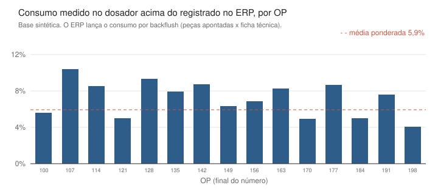

# Caso de investimento em dosadores gravimétricos

Estudo que cruza o consumo de matéria-prima registrado no ERP com o consumo pesado pelo dosador gravimétrico de uma injetora, e transforma a diferença em um caso de investimento para ampliar a frota de dosadores.

> Os dados deste repositório são **sintéticos**, gerados por `scripts/gerar_dados_sinteticos.py`. O método, as perguntas e as conclusões vêm de um projeto real, com volumes, preços e resultados financeiros trocados.



## O problema

A empresa queria saber se valia a pena comprar mais dosadores gravimétricos. O fornecedor tinha um número de catálogo, e a planta tinha uma impressão. Ninguém tinha o consumo real de material por ordem de produção.

## O que descobri

**1. O ERP não mede consumo de matéria-prima, ele calcula.** Dentro de cada OP, a razão entre quantidade emitida e planejada é idêntica em todas as linhas da ficha técnica: resina, pigmento, etiqueta, caixa e até hora-máquina. Isso só acontece com backflush, em que o sistema multiplica as peças apontadas pela ficha. Nenhum quilo é pesado, e o dosador passa a ser a única fonte de consumo medido.

**2. O desvio é de volume, não de mistura.** O dosador consome em média 5,9% a mais de material que o ERP registra (base sintética), e o gap é o mesmo na resina e no pigmento. O percentual de pigmento medido fica colado na receita, com desvio máximo de 0,004 p.p. hora a hora. Ou seja, o dosador acerta a mistura, e a diferença está em material que entra na máquina e não vira peça apontada.

**3. O percentual é a métrica errada para o gap.** Ele varia com o tamanho da OP. Convertido em peças equivalentes, o gap fica mais estável entre OPs, e é essa a métrica que permite comparar ordens diferentes.

**4. O ganho vale a diferença de preço, não o preço do pigmento.** A massa da peça não muda quando se usa menos pigmento: o que sai de masterbatch entra de resina. A primeira versão do caso valorava o kg poupado pelo preço cheio do masterbatch e superestimava o ganho.

## O caso de investimento

O ganho recorrente do equipamento vem de duas alavancas sobre o pigmento, que é o item caro:

| Alavanca | O que é |
|---|---|
| B1 | Evitar a sobredosagem que o dosador volumétrico pratica por segurança |
| B2 | Reduzir o percentual de pigmento da receita, porque a precisão dispensa a margem |

O script `caso_financeiro.py` calcula payback, VPL, TIR e o teto de CAPEX que ainda paga o investimento. Todas as premissas ficam no topo do arquivo e são ilustrativas.

| Indicador (premissas ilustrativas) | Valor |
|---|---:|
| Ganho por máquina/ano (B1 + B2) | R$ 22.034 |
| Investimento (6 máquinas) | R$ 252.000 |
| Payback | 23 meses |
| VPL 5 anos a 15% | R$ 191.157 |
| TIR | 44% a.a. |

## Como a base foi saneada

Nenhum número foi calculado antes de classificar cada OP medida:

| Regra | Por quê |
|---|---|
| Consumo abaixo de 1 kg sai da conta | separa parada, setup e OPs de teste digitadas no painel |
| OP sem correspondente no ERP sai da conta | não há contra o que comparar |
| OP em execução aguarda | o backflush só fecha quando a OP fecha |

Mais detalhes em [metodologia](docs/metodologia.md).

## Estrutura

```
dados/      criado por scripts/gerar_dados_sinteticos.py (semente fixa)
docs/       metodologia e gráfico
scripts/    geração da base, análise do gap, caso financeiro e gráfico
```

## Rodando

```bash
pip install -r requirements.txt
python scripts/gerar_dados_sinteticos.py   # cria os CSVs em dados/
python scripts/analise_gap.py              # backflush, gap por componente, precisão e métricas
python scripts/caso_financeiro.py          # alavancas, payback, VPL, TIR e teto de CAPEX
python scripts/grafico_gap.py              # gera docs/gap-por-op.svg
```

**Stack:** Python (pandas, SciPy) · PostgreSQL/TimescaleDB · OPC-UA · SAP Business One · Power BI

---

Rafael Gomes · [LinkedIn](https://www.linkedin.com/in/rafael-gomes-analista-de-dados) · [Portfólio](https://app.xperiun.com/in/rafagomes)
